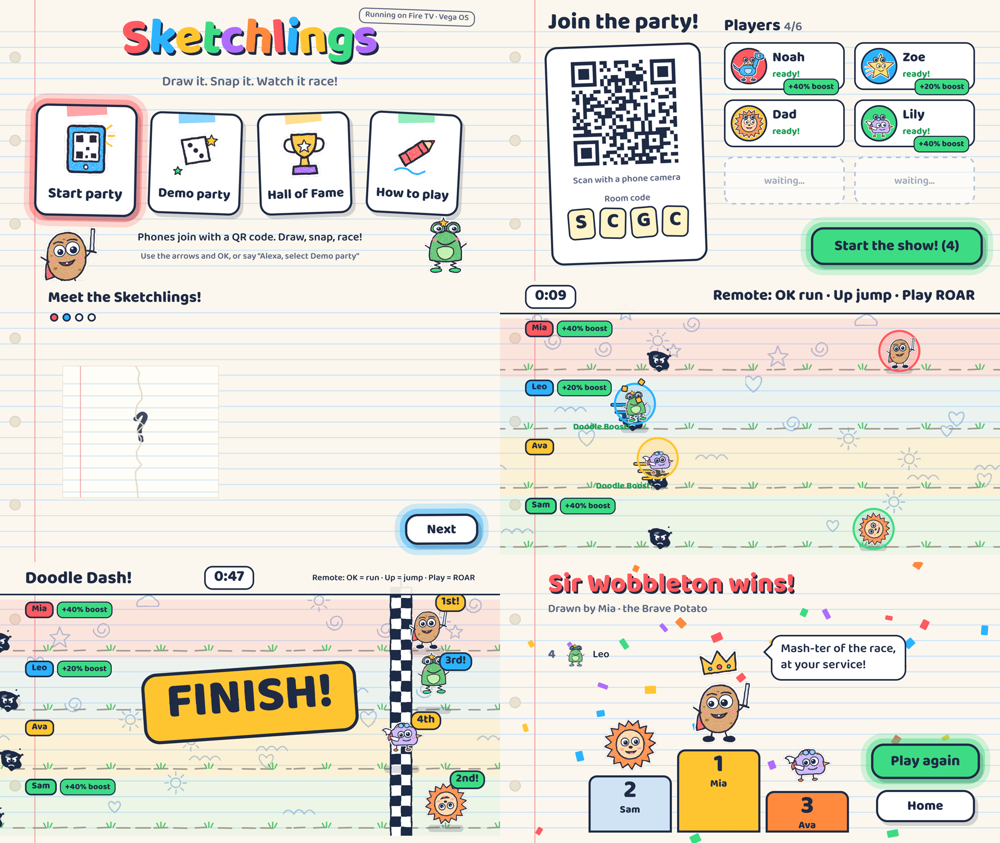
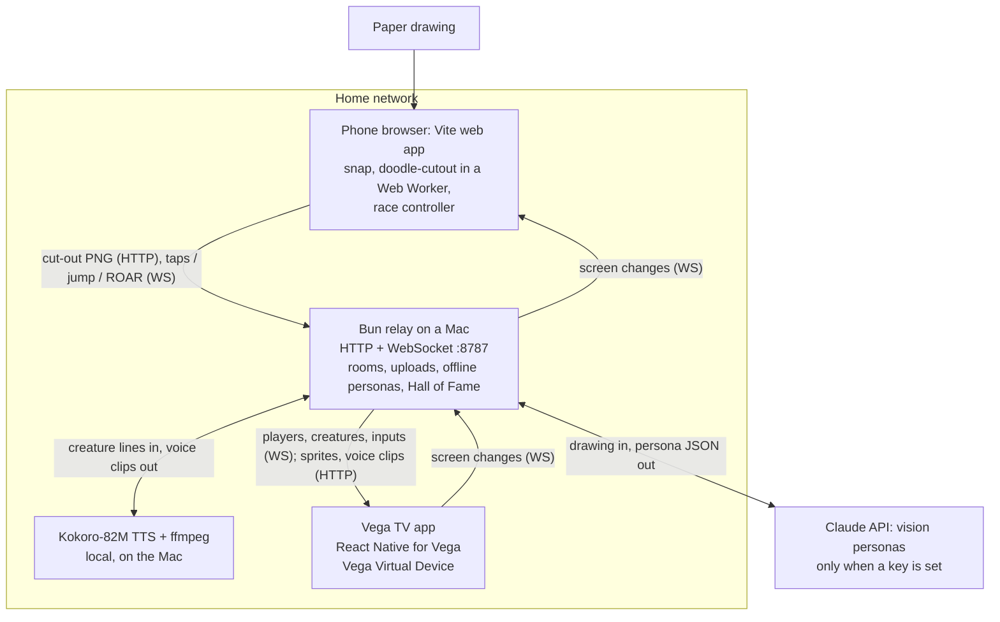

# Sketchlings

**Kids draw a creature on paper. Seconds later it walks onto the Fire TV, says hello in its own voice, and races the family. What you draw changes how you play, and age boosts give the youngest a real shot at winning.**

A native Fire TV app built with **React Native for Vega** on the **Vega SDK 0.24**. Phones join with a QR code, snap the drawing and cut it out on the phone, then become race controllers. A small relay on the home network gives each creature a name, stats, an ability and a voice, with **Claude vision** or a fully offline generator.

Fire TV track, Amazon "Build, Ship, Shape" hackathon 2026. Built and tested on the **Vega Virtual Device only**: not yet run on Fire TV hardware, not on the Appstore. MIT licence. Made by Harindu, StarFun Games, Sri Lanka.

- Video (under 3 minutes): TBD
- Open-source library from this project: **doodle-cutout**, [github.com/Harindulk/doodle-cutout](https://github.com/Harindulk/doodle-cutout) (MIT, 39 tests; also in [`packages/doodle-cutout`](packages/doodle-cutout))
- [Friction log](FRICTION_LOG.md) · [Product feedback](docs/PRODUCT_FEEDBACK.md) · [Impact and launch memo](docs/IMPACT.md) · [How it came to be](docs/journey/)



<p align="center">
  
  
  
</p>

More screenshots: [`notes/shots/`](notes/shots) (TV, from the VVD) and [`phone/docs/screens/`](phone/docs/screens).

## Try it in 2 minutes: Demo party, remote only

No phones, no relay, no API key. Four sample Sketchlings introduce themselves and race; you play the first racer with the remote.

You need the Vega SDK 0.24 with the Vega Virtual Device (Amazon's one-line installer), Node 22.14 or newer, and `adb` (Android SDK platform-tools) to drive a headless VVD. Tested on an Apple-silicon Mac only. `npm install` and the build take about a minute each.

```sh
git clone https://github.com/Harindulk/sketchlings.git ~/sketchlings   # a path WITHOUT spaces (FRICTION_LOG #7)
source ~/vega/env
vega virtual-device start --no-gui --timeout 300   # headless; on macOS 27 the VVD window crashes (FRICTION_LOG #2)
cd ~/sketchlings/tv && npm install                 # plain install, no .npmrc (FRICTION_LOG #8)
scripts/vbuild.sh release --run                    # builds in a mirror folder, installs and launches on the VVD
```

On Home press **Right** once to reach **Demo party**, then **OK**. In the race: **OK** = run, **Up** = jump, **Play/Pause** = ROAR, **Menu** = performance overlay, **Back** = up one level.

Headless, drive and watch the VVD from the terminal:

```sh
scripts/remote.sh right      # remote keys: up down left right select back menu playpause [count]
scripts/remote.sh select
scripts/remote.sh shot home.png
```

Demo party tries the relay's Hall of Fame for 3 seconds, then uses the bundled samples. Narrator lines are bundled in the app; creature voices need the relay (live mode, below).

## Tech Implementation

**We root-caused a deadlock inside Vega's own JS-thread watchdog.** About 1 race start in 4 froze on "3" and the app was later killed as AppNotResponding, with "No JavaScript code is currently being executed". The crash report only unwinds the main thread, but it also embeds a full core dump, so we read the core dump's thread stacks with symbol names from the device libraries ([`tv/scripts/acr-stacks.py`](tv/scripts/acr-stacks.py), reusable on any Vega ACR). Five reports show the same picture: the JS thread blocked in a `send()` to the watchdog's wake-up socket while holding the watchdog loop's mutex, and the loop thread, the only reader of that socket, waiting for the same mutex. A classic ABBA deadlock that the watchdog can't report, because it is one of the stuck threads. The app now starves it of wake-ups: one JS task per frame, animated values native from birth and a silent race. At 6 lanes the trigger was an image-mount burst (about 66 ink-blot images mounting in the same instant as the race; 3 of 7 starts froze), so the blots now mount one lane at a time during the countdown. **52 race starts on the fixed builds (42 at 4 lanes + 10 at 6 lanes), 0 freezes** (`tv/scripts/soak.mjs`). Full write-up and platform suggestions: [FRICTION_LOG #1](FRICTION_LOG.md#1-race-start-freeze-an-abba-deadlock-inside-vegas-js-thread-watchdog).

**A native Vega app built for the remote.** React Native for Vega (RN 0.83, `@amazon-devices/react-native-kepler` 4.0.1), built with `react-native build-vega`, installed with `vega run-app`.

| Vega API or package | What Sketchlings uses it for | Where |
|---|---|---|
| `TVFocusGuideView` (`autoFocus`) | D-pad focus groups on Home and Results | [`Home.tsx`](tv/src/screens/Home.tsx), [`Results.tsx`](tv/src/screens/Results.tsx) |
| `hasTVPreferredFocus` | focus starts on the obvious button on every screen | [`FocusButton.tsx`](tv/src/components/FocusButton.tsx) |
| `useTVEventHandler` | the remote plays a racer in Demo party; Menu toggles the perf overlay | [`Race.tsx`](tv/src/screens/Race.tsx) |
| `BackHandler` | Back goes up one level; on Home the system closes the app | [`App.tsx`](tv/src/App.tsx) |
| `useKeplerAppStateManager` | in the background: drop queued voice lines and close the party socket; back in front: rejoin the same room | [`App.tsx`](tv/src/App.tsx), [`party.ts`](tv/src/game/party.ts) |
| `aria-label` + `com.amazon.category.kva` | targets for Alexa on-screen voice selection, per the Vega docs (declared; not testable on the VVD) | [`FocusButton.tsx`](tv/src/components/FocusButton.tsx), [`manifest.toml`](tv/manifest.toml) |
| `@amazon-devices/react-native-w3cmedia` 2.3.2 | creature voices and narrator: one long-lived `AudioPlayer` + one `MediaSource`/SourceBuffer for the session (a new source per clip crashed libW3CMedia, FRICTION_LOG #5), eight `[wants]` services | [`audio.ts`](tv/src/audio.ts), [`manifest.toml`](tv/manifest.toml) |
| `@amazon-devices/react-native-qrcode-svg` + `react-native-svg` | the join QR code | [`Lobby.tsx`](tv/src/screens/Lobby.tsx) |
| `@amazon-devices/kepler-performance-api` (`useReportFullyDrawn`) | Time to Fully Drawn on Home's first frame | [`Home.tsx`](tv/src/screens/Home.tsx) |
| `Animated` on the native driver, `Animated.modulo` | the race and its parallax with no React render per frame | [`Race.tsx`](tv/src/screens/Race.tsx) |

**Built for TV performance.**
- The race is a pure TypeScript simulation ([`race.ts`](tv/src/game/race.ts), Jest-tested). Each frame writes positions into native-driver `Animated` values, only when a value changed. Phone taps reach the race through listeners, not React state, so six players tapping cause no re-renders.
- Animation graphs are built once and memoised; googly-eye pupils ride a spring.
- The media stack loads lazily, so it costs nothing at launch.

**KPIs, measured on the Vega Virtual Device (headless, Apple-silicon host, no Fire TV hardware).** These are engineering observations, not Fire TV hardware performance: Amazon's own docs list the VVD as "Not supported for performance testing" ([Run Your App Overview](https://developer.amazon.com/docs/vega/0.24/run-apps-overview.html)). Performance on hardware is not yet verified.

| KPI | Vega target | Sketchlings | How, when |
|---|---|---|---|
| Time to First Frame, cool start | < 1.5 s | **665 ms** mean (min 631, max 719) | KPI Visualizer `--kpi cool-start-latency`, 10 of 10 runs, 21 Oct, host under load |
| Time to Fully Drawn, cool start | < 8 s | **665 ms** mean | same run (`useReportFullyDrawn` on Home's first frame) |
| App memory | < 400 MiB (foreground) | **124-284 MiB**: 124 on Home, 233 peak after three races, 284 after the Hall of Fame and six 6-lane races | `vega exec perf activity-monitor`, 21 Oct |
| Race loop rate and JS time per frame | 60 Hz | **55-62 Hz**, 0.3-0.5 ms of JS per frame (6 lanes) | in-app overlay, 21 Oct |
| Phone input, received to applied in the race | none set | **6-9 ms** (n = 300, 6 lanes) | simulated phones on the same Mac, in-app timing, 21 Oct |
| Race-start freezes | 0 | 0 in 52 race starts on the fixed builds (42 at 4 lanes + 10 at 6 lanes) | `soak.mjs`, 21 Oct |
| Time to First Frame, warm start | < 0.5 s | not measurable on the VVD | the KPI Visualizer's prep step opens the Fire TV launcher (`com.amazon.smplighthouse.launcher.main`), but the VVD's launcher is `com.amazon.keplerlauncherapp.main`: 0 of 5 runs completed (FRICTION_LOG #24) |
| Foreground memory (KPI Visualizer) | < 400 MiB | not measured | `--kpi memory` and `--kpi foreground-memory` stop with "Appium server is not found" (#24); app memory above is from `activity-monitor` instead |
| UI fluidity | > 99% | not measured | `--kpi ui-fluidity` stops with the same Appium error (#24) |
| Focus response | < 200 ms | not measured | needs an Appium-driven scenario (#24) |

The absolute phone-to-TV time can't be measured from the VVD, whose clock ran 2 h 11 min behind the Mac (FRICTION_LOG #18).

**Computer vision and AI that do real work.**
- [`doodle-cutout`](packages/doodle-cutout) is ours: open source, zero dependencies, 39 tests. It flattens lamp light and phone shadows, finds the ink, closes small gaps, fills outlines into solid stickers, and drops table edges and crumbs. It runs on the phone in a Web Worker, so only the cut-out drawing is uploaded.
- Claude vision (`claude-opus-5-5`, effort low, structured JSON output) reads the drawing and returns a name, title, personality, three lines, stats that match the body, a move style, the drawn feature behind its ability ("big wings" means it flies over ink blots), and where the child drew the eyes. Every field is validated and clamped; a 12 s timeout or any problem falls back to the offline generator.
- The offline generator is a real fallback: stats from ink coverage and shape, the ability from the silhouette, colours from the drawing, and an eye finder that reports only a convincing pair of dark dots.
- Googly eyes with spring physics land on the drawn eyes. When the child drew eyes that can't be placed, the TV adds none, so no creature gets four eyes.

| Pipeline step, measured on the Mac relay | Result |
|---|---|
| Claude persona (`claude-opus-5-5`, 11 real scans, 21 Oct) | median **about 4.3 s** (3.7-5.3 s; first cold call 7.2 s), **about $0.015 per creature** (2.4-2.7k tokens in, 210-255 out) |
| Offline persona | first frame to the TV 12-23 ms after the upload |
| Voices (Kokoro-82M, three lines) | about 4.3 s on an M5 MacBook; with Claude, clips ready 7-13 s after the upload |
| Cutout on the phone | under 0.4 s for a 900×675 photo in a desktop browser; not yet timed on a phone |

**Voices made at home.** Kokoro-82M (Apache-2.0) speaks each creature's intro, catchphrase and win line. It runs on the home relay (a Mac today), not on the TV and not in the cloud. The voice is picked from the creature's name, title and stats (10 base voices, pitch shifted -3.1 to +5.1 semitones), so a creature always sounds the same. ffmpeg normalises to -18 LUFS and encodes AAC in fragmented MP4 for w3cmedia.

**Robust in a living room.** Phones reconnect with backoff and rejoin as the same player after a reload. If the relay restarts, the TV recreates its room under the same code, so the QR code on screen stays valid. Every WebSocket frame is validated (64 KB cap), uploads are checked for type and size, and the Hall of Fame file is written atomically.

**Built with Amazon Devices Builder Tools.** The ADBT steering doc ([`CLAUDE.md`](CLAUDE.md)) and Vega skills ran inside Claude Code. The media-player skill pointed at missing `[wants]` services as the cause of silent playback, which is where audio setup went wrong; the performance skill led to the KPI Visualizer numbers above. ADBT's `symbolicate_acr` failed on the VVD (FRICTION_LOG #11), which is why we wrote `acr-stacks.py`, and its `analyze_perfetto_traces` couldn't find the Vega Perf CLI, so the cool-start traces were not analysed (#24).

**Tests** (run on 22 Oct): **120 automated tests**. 63 for the relay over real HTTP and WebSocket (`cd server && bun test`; 3 skip without ffmpeg or the voice model), 39 for doodle-cutout (`cd packages/doodle-cutout && bun test`), 16 Jest tests for the race simulation, ability balance, Demo party and the voice player (`cd tv && npx jest`), 2 for the phone app (`cd phone && bun test`). The phone app is also typechecked (`cd phone && npm run typecheck`).

## Design

- **One loop, no dead ends.** Home → Lobby → draw and snap → Reveal → Doodle Dash → Results → Play again, or Home and the Hall of Fame. Back always goes up one level, and focus returns to the Home tile you came from.
- **Each input does what it is best at.** Paper for creating. The phone for snapping and racing: a giant multi-touch tap pad, swipe up to jump, a ROAR button. The remote for menus, and for Demo party.
- **Joining is one scan.** A QR code plus a 4-letter room code; a first name and an age group, no accounts. Room codes have no vowels, so they never spell words.
- **Made for ages 4 to 10.** Big buttons, little reading. Fairness you can see: "+40% boost" for little kids and "+20%" for big kids, plus a Doodle Boost for whoever falls behind.
- **What you draw changes how you play.** Wings fly over ink blots, wheels roll faster on flat ground, long legs jump higher, a big body's ROAR knocks blots away. The Lobby, How to play and the phone tell kids this before they draw, and the race pops WINGS!, WHEELS!, SPRINGS! or BIG ROAR! when it helps.
- **Characters, not sprites.** Each drawing tears out of the paper, gets googly eyes on its own drawn eyes and introduces itself in its own voice. Every voiced line is also on screen as a caption.
- **A look that matches the activity.** Notebook paper, sticker cards that lift, glow and wobble when focused, readable from 10 feet. TV and phone share it. All art is ours.
- **Changed by the cold test:** TBD

## Potential Impact

- **Who it is for:** households with kids aged about 4 to 10, and the adults on the couch with them. Kids make the content and can beat an older sibling; parents get screen time that starts with crayons.
- **Why families come back:** the Hall of Fame keeps every creature (the newest 200) with the artist's name, and **Race again** brings a saved creature back into the next race.
- **Evidence:** no child has played it yet. Kids' drawings, scanned with a grown-up's OK (no children filmed): TBD. [Cold test](docs/playtest/cold-test.md) with adults who had never seen the game and got one instruction, "Get two creatures into a race": TBD. Fairness is simulated, not playtested ([docs/FAIRNESS.md](docs/FAIRNESS.md)): with assumed tap rates and the real race engine, a little kid beats a grown-up who is trying in about 1 race in 4 with the +40% boost, and about 1 in 100 without it.
- **It pays for itself:** about $0.015 of Claude per creature (measured). Plan: a free game with offline personas, plus a $4.99-a-year Family Pass through Amazon In-App Purchasing (not built yet) for up to 200 AI creatures, behind a parent gate. A free household costs about 2 cents a month to run, and the Pass's 200-creature cap means it costs at most about $3.25 a year against the $3.49 the store passes on (estimates at 10,000 households; at 1,000 a fully used Pass costs about $4.15 and loses money, while a light family still fits).
- **Launch plan:** a cloud relay on AWS Fargate with Claude through Amazon Bedrock, a grown-up consent step, COPPA-minded data rules. If every household made 20 AI creatures a month it would cost about $0.40 a household a month at 1,000 households and $0.32 at 10,000 (estimate), with Claude three-quarters to over 90% of it. Details: [docs/IMPACT.md](docs/IMPACT.md).

## Quality of the Idea

- **An unusual chain:** paper, phone camera, open-source computer vision, LLM vision, a generated voice, and a real-time race on the TV.
- **A gap in the field.** We looked through the 186 public Fire TV entries we found on GitHub on 20 Oct. Movement and fitness games were crowded, and none turned a child's drawing into a character you *play*, so we switched to this idea (two entries we found later, Crayon Cinema and Doodle Theater, turn a child's drawing into the star of a bedtime story on Fire OS, where the remote picks what happens next; we found none where the drawing becomes a racer you control in real time against your family, with abilities that come from what was drawn, natively on Vega) ([journey](docs/journey/)).
- **The AI does work the game needs:** stats that match the body, an ability from what was drawn, eye positions for the googly eyes, lines in character. The game still works without it.
- **Four of the track's priority areas:** computer vision, AI, multi-modal input (paper, phone, remote) and family entertainment. Real-time racing, not turn-based quiz rounds.

## Known limits

- **Vega Virtual Device only.** Never run on Fire TV hardware. All KPIs are VVD engineering observations; Amazon says the VVD is not for performance testing, so hardware performance is not yet verified.
- **No child playtest.** No child plays or is filmed: the evidence plan is kids' drawings scanned with a grown-up's OK and a cold test with adults. Whether little kids manage the controller, enjoy it and really win is still untested.
- **The race loop is paced with `setTimeout`, not vsync.** On the headless VVD `requestAnimationFrame` free-runs at about 7,600 a second (FRICTION_LOG #4), and fewer JS tasks keep the watchdog deadlock away (#1). We'll move to `requestAnimationFrame` once it is tested on hardware.
- **The deadlock is less likely, not ruled out.** It is a platform bug; the app only avoids feeding it.
- **The race is silent.** Audio work can stall or hang the JS thread on the VVD (#5), so voices play only on Reveal and Results, and captions carry every line. Voices play through the Vega W3C media player; a media-player crash (a new MediaSource per clip) was root-caused and fixed with one long-lived source, 0 crashes over 73 screens since ([FRICTION_LOG #5](FRICTION_LOG.md#5-audio-work-stalls-or-hangs-the-js-thread-on-the-vvd)). The VVD's audio reaches the Mac's speakers, but we couldn't record it.
- **It needs a relay on the home network today:** a Mac running Bun, Kokoro and ffmpeg, with `HOST = '10.0.2.2:8787'` in `tv/src/config.ts` (the VVD's address for its host). The plan to remove it is in [docs/IMPACT.md](docs/IMPACT.md).
- **Alexa voice selection is declared, not shown.** Every button has an `aria-label` and the manifest has the `kva` category, per the Vega docs, but voice can't be tested on the VVD.
- **Mic shouting works only over HTTPS** (browsers allow the microphone only on secure pages): run `scripts/tunnel.sh` for a temporary HTTPS link. On the plain-HTTP LAN page the ROAR button, which always works, is the way to ROAR.
- **The phone app ran in desktop browsers at phone size (375×812).** TBD
- Voices are made one at a time: with six scans at once, the last voice can take 30-40 s.

## Privacy and child safety

**With an API key, the cut-out drawing goes to Anthropic for the persona. With the HTTPS tunnel, phone traffic passes through Cloudflare. In offline mode nothing leaves the home network.**

- **The path of a drawing:** the photo stays on the phone → the phone cuts the drawing out → only the cut-out PNG goes to the relay → Claude, today only when the relay has an API key, at launch only after a grown-up's consent (offline mode skips this step) → a structured, schema-checked, word-guarded persona → the TV.
- **What leaves the phone:** the cut-out drawing (PNG, at most 1024 px a side), a first name, an age group and race taps. The room photo never leaves the phone. The microphone, when enabled, is analysed on the phone for loudness only.
- **What goes to Claude:** the cut-out drawing, a note of its shape and colours, and creature names already taken. No child's name, age or taps.
- **Kind by design:** no accounts, ads, purchases or chat. The prompt allows only kind, playful text, must never mock a drawing and must ignore any writing in the image; every answer is schema-checked, and anything odd falls back to curated offline word lists. A word guard then checks every line Claude writes against a short list (violence, weapons, sexual words, drugs and alcohol, insults, brands and characters); a hit swaps that field for its offline version and is logged. It is a fixed English list, so it misses misspellings and other languages, and names typed on the phones are not checked.
- **Stored on the Mac:** `server/data/hall.json` (the newest 200 creatures with the artist's first name), their sprites and voice clips (deleted when a creature drops out of the newest 200), and a voice cache by text (never pruned today). Clearing everything means stopping the relay and deleting `server/data/`; a parent "Clear Hall of Fame" button is on the launch checklist.
- Launch plan (consent step, COPPA, Appstore kids rules, data deletion): [docs/IMPACT.md](docs/IMPACT.md#kids-safety-and-privacy).

## Full setup: a live party with phones

| Tool | Version we used | Needed for |
|---|---|---|
| Vega SDK + Vega Virtual Device | SDK 0.24.12112, Vega CLI 1.4.5 | the TV app |
| Node | 26.12 (`react-native-kepler` 4.0.1 asks for 22.14+) | TV and phone builds |
| Bun | 1.4.3 | the relay |
| ffmpeg | Homebrew | creature voices (optional) |
| adb (Android SDK platform-tools) | 37.0.1 | headless VVD keys and screenshots |

Tested on macOS 27.0.1, Apple silicon. Not tested on Ubuntu or on Fire TV hardware.

**1. Relay (Bun).**

```sh
cd server
bun install
cp .env.example .env     # optional: ANTHROPIC_API_KEY=... (read "Privacy and child safety" first)
bun run tts:download     # optional, once: Kokoro-82M voice model (~330 MB) into server/models/; needs ffmpeg
bun run start            # listens on 0.0.0.0:8787 and prints the phone join address
```

- No key: every creature comes from the offline persona generator. No voice model or no ffmpeg: creatures are silent. Everything else works.
- Start it from `server/`: Bun only loads `.env` from the current folder, and shell variables win. Other settings (`SKETCHLINGS_MODEL`, `ANTHROPIC_WORKSPACE_ID`, `PUBLIC_URL`, `PORT`): [`server/README.md`](server/README.md).
- For mic shouting, start `scripts/tunnel.sh` instead: it runs the relay behind a temporary Cloudflare HTTPS link, and phones join through it.

**2. Phone app (Vite).** `cd phone && npm install && npm run build`. The relay serves `phone/dist` at `/j/<ROOM>`; phones install nothing.

**3. TV app.** Build and launch as in "Try it in 2 minutes", then choose **Start party**. On a real Fire TV (not tested), set `HOST` in `tv/src/config.ts` to the Mac's LAN IP and rebuild.

**4. Play.** Phones on the same Wi-Fi scan the QR code (or type the 4-letter room code), enter a first name and pick Little kid, Big kid or Grown-up. Draw with a thick marker, tap **Snap my drawing** (or **Draw on screen instead**), then race: tap to run, swipe up to jump, press ROAR. No phones to hand? `node tv/scripts/fake-phones.mjs <ROOM> 3` adds simulated players that upload drawings and race.

## Architecture



On a scan: the phone cuts the drawing out and uploads only the PNG; the relay makes the persona (Claude, or offline on any error) and sends it to the TV; then it voices the three lines with Kokoro and sends a second frame with the voice URLs; the TV loads the sprite and clips over HTTP. The contract between the three apps is one file, [`shared/protocol.ts`](shared/protocol.ts).

| Folder | Stack | Job |
|---|---|---|
| [`tv/`](tv) | React Native for Vega (RN 0.83), Vega SDK 0.24 | every TV screen and the race |
| [`server/`](server) | Bun + TypeScript | rooms, WebSocket relay, uploads, personas, voices, Hall of Fame, serves the phone app |
| [`phone/`](phone) | Vite + TypeScript, no framework | join, snap or finger-draw, cutout, race controller |
| [`packages/doodle-cutout/`](packages/doodle-cutout) | TypeScript, zero dependencies, MIT | photo of a paper drawing to a clean sticker sprite |
| [`shared/protocol.ts`](shared/protocol.ts) | TypeScript types | the contract between all three apps |

## Built with

- React Native for Vega (RN 0.83, `@amazon-devices/react-native-kepler` 4.0.1), Vega SDK 0.24 (Vega CLI 1.4.5), Vega Virtual Device, Vega Perf CLI (KPI Visualizer)
- Amazon Devices Builder Tools (MCP server and Vega skills), with Claude Code
- `@amazon-devices/react-native-w3cmedia` 2.3.2, `@amazon-devices/react-native-qrcode-svg` 3.0.0 with `@amazon-devices/react-native-svg`, `@amazon-devices/kepler-performance-api` 0.1.4
- Claude API (`@anthropic-ai/sdk`), vision personas with structured outputs
- Kokoro-82M text-to-speech (`kokoro-js`), ffmpeg on the host
- doodle-cutout (ours, MIT), Bun, Vite, TypeScript

## Credits and licences

- Code: MIT © 2026 StarFun Games, see [`LICENSE`](LICENSE).
- Kokoro-82M model and voices: Apache-2.0 (hexgrad; ONNX export by onnx-community). Runs on the host only.
- eSpeak NG: GPL-3.0-or-later, inside the `phonemizer` package that Kokoro uses on the host. `bun install` fetches it; it is not vendored here and never ships in the TV app.
- Fonts: Baloo 2 (TV and phone) and Patrick Hand (phone), SIL Open Font License 1.1, bundled with their licence files ([`tv/assets/fonts/OFL.txt`](tv/assets/fonts/OFL.txt)).
- ffmpeg: a host tool, called as a separate process, not distributed.
- Art: all ours ([`tv/art-src/`](tv/art-src), inline SVG in the phone app). Audio: all generated by this project.
- Video music: "Happy Clappy Loop" by OwlishMedia and "Happy Beat" by burabotti, both CC0 1.0 from OpenGameArt .
- Full lists: [`server/CREDITS.md`](server/CREDITS.md), [`phone/CREDITS.md`](phone/CREDITS.md).
