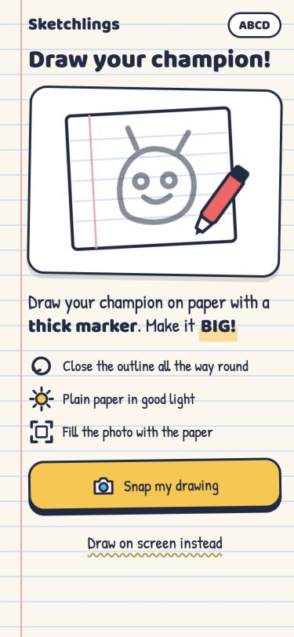
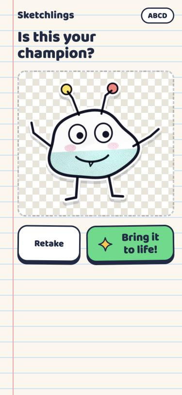
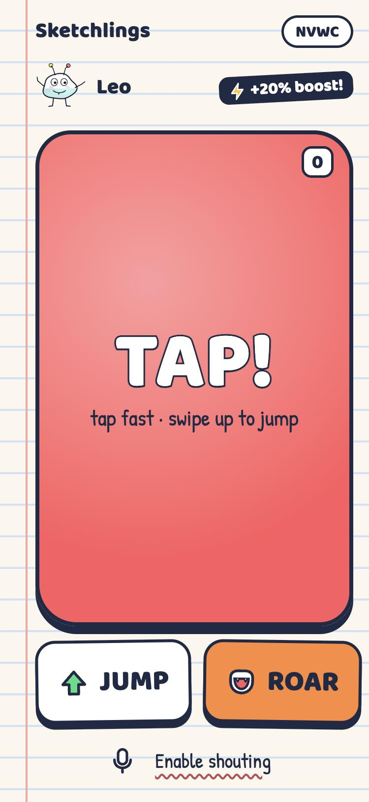
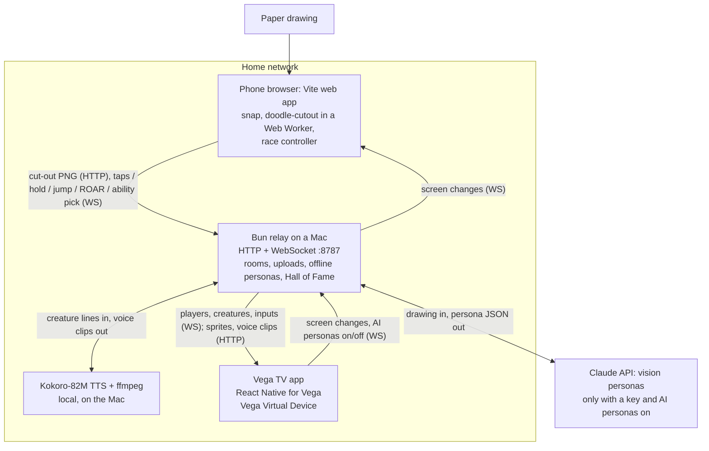

# Sketchlings

**Kids draw a creature on paper. Seconds later it walks onto the TV, says hello in its own voice, and races the family. What you draw changes how you play, and the youngest get a visible speed boost.**

A native Fire TV app built with **React Native for Vega** on the **Vega SDK 0.24**. Phones join with a QR code, snap the drawing and cut it out on the phone, then become race controllers. A small relay on the home network gives each creature a name, stats, an ability and a voice, with **Claude vision** or a fully offline generator.

Fire TV track, Amazon "Build, Ship, Shape" hackathon 2026. Built and tested on the **Vega Virtual Device only**: not yet run on Fire TV hardware, not on the Appstore. MIT licence. Made by Harindu, StarFun Games, Sri Lanka.

- Video (under 3 minutes): link added on submission day
- Open-source library from this project: **doodle-cutout**, [github.com/Harindulk/doodle-cutout](https://github.com/Harindulk/doodle-cutout) (MIT, 42 tests; linked here as the git submodule [`packages/doodle-cutout`](packages/doodle-cutout). Cloned without `--recursive`? Run `git submodule update --init`)
- [Friction log](FRICTION_LOG.md) · [Product feedback](docs/PRODUCT_FEEDBACK.md) · [Impact and launch memo](docs/IMPACT.md) · [Fairness simulation](docs/FAIRNESS.md) · [How it came to be](docs/journey/)


<p align="center">
  
  
  
</p>

More screenshots: [`notes/shots/`](notes/shots) (TV, from the VVD) and [`phone/docs/screens/`](phone/docs/screens).

## Try it in 2 minutes: Demo party, remote only

No phones, no relay, no API key. Four sample Sketchlings introduce themselves (their lines on screen; creature voices need the relay) and race; you play the first racer with the remote.

You need the Vega SDK 0.24 with the Vega Virtual Device (Amazon's one-line installer), Node 22.14 or newer, and `adb` (Android SDK platform-tools) to drive a headless VVD. Tested on an Apple-silicon Mac only. `npm install` and the build take about a minute each.

```sh
git clone --recursive https://github.com/Harindulk/sketchlings.git ~/sketchlings   # a path WITHOUT spaces (FRICTION_LOG #7); --recursive fetches doodle-cutout
source ~/vega/env
vega virtual-device start --no-gui --timeout 300   # headless; on macOS 27 the VVD window crashes (FRICTION_LOG #2)
cd ~/sketchlings/tv && npm install                 # plain install, no .npmrc (FRICTION_LOG #8)
scripts/vbuild.sh release --run                    # builds in a mirror folder, installs and launches on the VVD
```

`--run` installs the arm64 package (`build/aarch64-release/`), which suits an Apple-silicon Mac. On an x86_64 host, install the x86_64 package from the build mirror (`$TMPDIR/sketchlings-vbuild/sketchlings/tv/build/x86_64-release/*.vpkg`) with `vega run-app` instead (not tested).

On Home press **Right** once to reach **Demo party**, then **OK**. In the Lobby, wait until it says **Everyone is ready!** (about 7 s), then press **OK** on **Start the show! (4)**. In the race: **OK** = run, **Up** = jump, **Play/Pause** = ROAR, **Menu** = performance overlay, **Back** = up one level.

Headless, drive and watch the VVD from the terminal:

```sh
scripts/remote.sh right      # remote keys: up down left right select back menu playpause [count]
scripts/remote.sh select
scripts/remote.sh shot home.png
```

Demo party tries the relay's Hall of Fame for 1.5 seconds, then uses the bundled samples. Narrator lines are bundled in the app; creature voices need the relay (live mode, below).

## Tech Implementation

**We traced a race-start freeze to a deadlock inside Vega's own JS-thread watchdog.** About 1 race start in 4 froze on "3" and the app was later killed as AppNotResponding. The crash report only unwinds the main thread, but it also embeds a full core dump, so we read its thread stacks with symbol names from the device libraries ([`tv/scripts/acr-stacks.py`](tv/scripts/acr-stacks.py), reusable on any Vega ACR). Five reports show the same ABBA deadlock: the JS thread blocked in a `send()` to the watchdog's wake-up socket while holding the loop's mutex, and the loop thread, that socket's only reader, waiting for the mutex. That is our reading of the stacks; Amazon has not confirmed it. The app now starves it of wake-ups: one JS task per frame, animated values native from birth, no audio work per frame, ink blots mounted one lane at a time during the countdown, and Hall of Fame rows mounted as the focus reaches them, never all at once. **105 race starts since the last fix, 0 frozen** (`tv/scripts/soak.mjs`, 4-6 lanes), 70 of them with race audio (30 on 22 Oct, 40 on the 23 Oct build `d8a8f4e`; the final build with the Reveal-voice change, `998da27`, then ran 20 more starts, 0 frozen). Across every fixed build since 21 Oct: 1 in 209, on an interim build while a Reveal voice played into the countdown. The Hall of Fame froze on 2 of 13 visits while screen-recording, when all 74 cards mounted at once; 42 visits since, 0 frozen. Zero in 105 still allows a freeze rate of up to about 3% at 95% confidence: rarer, not impossible. Full write-up and platform suggestions: [FRICTION_LOG #1](FRICTION_LOG.md#1-race-start-freeze-an-abba-deadlock-inside-vegas-js-thread-watchdog).

**A native Vega app built for the remote.** React Native for Vega (RN 0.83, `@amazon-devices/react-native-kepler` 4.0.1), built with `react-native build-vega`, installed with `vega run-app`.

| Vega API or package | What Sketchlings uses it for | Where |
|---|---|---|
| `TVFocusGuideView` (`autoFocus`) | D-pad focus groups on Home and Results | [`Home.tsx`](tv/src/screens/Home.tsx), [`Results.tsx`](tv/src/screens/Results.tsx) |
| `hasTVPreferredFocus` | focus starts on the obvious button on every screen (on the Grown-ups gate, on a wrong answer) | [`FocusButton.tsx`](tv/src/components/FocusButton.tsx), [`GrownUps.tsx`](tv/src/screens/GrownUps.tsx) |
| `useTVEventHandler` | the remote plays a racer in Demo party; Menu toggles the perf overlay | [`Race.tsx`](tv/src/screens/Race.tsx) |
| `BackHandler` | Back goes up one level; in a live party it keeps the room, and the first Back on a Lobby with players only asks; on Home the system closes the app | [`App.tsx`](tv/src/App.tsx) |
| `useKeplerAppStateManager` | in the background: drop queued voice lines and close the party socket; back in front: rejoin the same room | [`App.tsx`](tv/src/App.tsx), [`party.ts`](tv/src/game/party.ts) |
| `aria-label` + `com.amazon.category.kva` | targets for Alexa on-screen voice selection, as we read the Vega docs (declared; not testable on the VVD) | [`FocusButton.tsx`](tv/src/components/FocusButton.tsx), [`manifest.toml`](tv/manifest.toml) |
| `@amazon-devices/react-native-w3cmedia` 2.3.2 | creature voices, the narrator and the race calls: one long-lived `AudioPlayer` + one `MediaSource`/SourceBuffer for the session (a new source per clip crashed libW3CMedia, FRICTION_LOG #5), eight `[wants]` services | [`audio.ts`](tv/src/audio.ts), [`manifest.toml`](tv/manifest.toml) |
| `@amazon-devices/react-native-qrcode-svg` + `react-native-svg` | the join QR code | [`Lobby.tsx`](tv/src/screens/Lobby.tsx) |
| `@amazon-devices/kepler-performance-api` (`useReportFullyDrawn`) | Time to Fully Drawn on Home's first frame | [`Home.tsx`](tv/src/screens/Home.tsx) |
| `Animated` on the native driver, `Animated.modulo` | the race and its parallax with no React render per frame | [`Race.tsx`](tv/src/screens/Race.tsx) |

**Built for TV performance.**
- The race is a pure TypeScript simulation ([`race.ts`](tv/src/game/race.ts), Jest-tested). Each frame writes positions into native-driver `Animated` values, only when a value changed. Phone taps reach the race through listeners, not React state, so six players tapping cause no re-renders.
- Animation graphs are built once and memoised; googly-eye pupils ride a spring.
- The media stack loads lazily, so it costs nothing at launch.
- The Hall of Fame mounts rows as the focus reaches them (9 cards at first, 3 more per row; rows already shown stay), so a full hall never mounts 74 cards in one go.

**VVD engineering observations (not Fire TV hardware KPIs).** Measured on the Vega Virtual Device, headless, on an Apple-silicon host with no Fire TV hardware. Amazon's own docs list the VVD as "Not supported for performance testing" ([Run Your App Overview](https://developer.amazon.com/docs/vega/0.24/run-apps-overview.html)), so the targets are for hardware and not comparable. Performance on hardware is not yet verified.

| What | Vega target (for hardware; ours where marked) | Sketchlings on the VVD | How, when |
|---|---|---|---|
| Time to First Frame, cool start | < 1.5 s | 665 ms mean (min 631, max 719) | KPI Visualizer `--kpi cool-start-latency`, 10 of 10 runs, 21 Oct, host under load |
| Time to Fully Drawn, cool start | < 8 s | 665 ms, the same as TTFF: Home needs nothing from the network, so the app reports "fully drawn" on Home's first frame | same run (`useReportFullyDrawn`) |
| App memory | < 400 MiB (foreground) | 124-284 MiB: 124 on Home, 233 peak after three races, 284 after the Hall of Fame and six 6-lane races | `vega exec perf activity-monitor`, 21 Oct |
| Race loop ticks a second and JS time per frame (one `setTimeout` per tick, not vsync) | 60 (ours) | 54-59, median 59, 0.2-0.3 ms of JS per frame (4 lanes, race audio on, 23 Oct). 6 lanes on a busier host on 22 Oct: 47-59, median 53, the same with and without race audio. 21 Oct, 6 lanes, silent race: 55-62 | in-app overlay |
| Phone input, received to applied in the race | none set | 6-9 ms (n = 300, 6 lanes) | simulated phones on the same Mac, in-app timing, 21 Oct |
| Wi-Fi round trip, relay to phone, during a race | none set | not measured on real phones yet; 0-1 ms on localhost | the relay pings each phone every 2 s in a race (WebSocket ping) and logs one line per race |
| Race-start freezes | 0 (ours) | 0 in 105 starts since the last fix (70 with race audio); 1 in 209 across every fixed build, on an interim build with a Reveal voice in the countdown | `soak.mjs`, 21-23 Oct |
| Hall of Fame freezes while screen-recording | 0 (ours) | 0 in 42 visits since the fix (2 in 13 before) | `adb emu screenrecord` running, 22-23 Oct |
| Time to First Frame, warm start | < 0.5 s | not measurable on the VVD | the KPI Visualizer's prep step opens the Fire TV launcher (`com.amazon.smplighthouse.launcher.main`), but the VVD's launcher is `com.amazon.keplerlauncherapp.main`: 0 of 5 runs completed (FRICTION_LOG #24) |
| Foreground memory (KPI Visualizer) | < 400 MiB | not measured | `--kpi memory` and `--kpi foreground-memory` stop with "Appium server is not found" (#24); app memory above is from `activity-monitor` instead |
| UI fluidity | > 99% | not measured | `--kpi ui-fluidity` stops with the same Appium error (#24) |
| Focus response | < 200 ms | not measured | needs an Appium-driven scenario (#24) |

The race loop is a timer-driven simulation, not tied to the display, which is why a reading can go above 60. The absolute phone-to-TV time can't be measured from the VVD, whose clock ran 2 h 11 min behind the Mac (FRICTION_LOG #18).

**Computer vision and AI that do real work.**
- [`doodle-cutout`](packages/doodle-cutout) is ours: open source, zero dependencies, 42 tests. It flattens lamp light and phone shadows, finds the ink, keeps faint strokes next to dark marker, closes small gaps, fills outlines into solid stickers, and drops table edges and crumbs. It runs on the phone in a Web Worker, so of the photo only the cut-out is uploaded. The finger-drawing pad uses its own settings, so a creature that touches the edge stays whole, and a photo whose "drawing" fills the whole frame gets the retake screen.
- Claude vision (`claude-opus-5-5`, effort low, structured JSON output) reads the drawing and returns a name, title, personality, three lines, stats that match the body, a move style, the drawn feature behind its ability ("big wings" means it flies over ink blots), and where the child drew the eyes. Every field is validated and clamped, and a word guard checks every line it writes ([Privacy and child safety](#privacy-and-child-safety)). The six text lines come all from Claude or all from the offline generator, so a card never shows two names. A 12 s limit on the whole answer or any problem falls back to the offline generator; `SKETCHLINGS_FAIL_EVERY=N` forces that fallback in soak tests (29 ms on 23 Oct).
- The offline generator is a real fallback: stats from ink coverage and shape, the ability from the silhouette, colours from the drawing, and an eye finder that reports only a convincing pair of dark dots.
- Googly eyes with spring physics land on the drawn eyes. The TV's rule (`Sprite.tsx`): use the eyes that were found; if the child drew eyes that couldn't be placed, add none; only a creature with no drawn eyes gets the default pair (`s.eyes?.length ? s.eyes : s.ownEyes ? [] : DEFAULT_EYES`). So no creature gets four eyes.
- The child has the last word: the creature card on the phone shows "I saw big wings → Flies over ink blots!", and four big buttons (Walker, Hopper, Flyer, Roller) change the ability before the race. The TV's Reveal then says "<artist>'s pick".

| Pipeline step, measured on the Mac relay | Result |
|---|---|
| Claude persona (`claude-opus-5-5`, 60 calls on 12 test images of 9 drawings, none by a child, 22 Oct) | median 4.7 s (p90 5.9 s, 3.7-8.3 s; first call 8.0 s), about $0.016 per creature (median $0.0159; 2.4-2.7k tokens in, 210-280 out); 60 of 60 answered, 0 fallbacks, 0 word-guard hits ([bench](notes/bench-persona.md)) |
| Same, live on the VVD with fake phones, 23 Oct | 4.8-5.2 s |
| Offline persona | first frame to the TV 12-23 ms after the upload |
| Upload to all three voice clips ready (the relay's `[scan] … upload->voices` line) | 13.3-13.5 s with 3 scans at once (23 Oct, AI personas on). 6 offline scans at once: each intro ready 2.7-16.3 s after the uploads, all lines 18.4-27.7 s |
| Voices (Kokoro-82M, three lines, one creature) | 4-7 s after its first frame on an M5 MacBook |
| Cutout on the phone | under 0.4 s for a 900×675 photo in a desktop browser; not yet timed on a phone |
| Snap to talking creature on a real phone | not measured on a real phone yet |

The relay logs the server side of the chain for every scan: `[scan] <player> upload->sketchling <ms> ms source=claude|offline` and `[scan] <player> upload->voices <ms> ms`. The TV then fetches the sprite and the clips over HTTP; that last step is not timed separately.

**Voices made at home, played on the TV.** Kokoro-82M (Apache-2.0) speaks each creature's intro, catchphrase and win line. It runs on the home relay (a Mac today), not on the TV and not in the cloud; the TV only plays the finished clips. The voice is picked from the creature's name, title and stats (10 base voices, pitch shifted -3.1 to +5.1 semitones), so a creature always sounds the same. ffmpeg normalises to -18 LUFS and encodes AAC in fragmented MP4 for w3cmedia. Every waiting intro is voiced before any other line, and the TV gets each intro as soon as it is ready, so with several scans at once every creature can introduce itself on the Reveal.

**Robust in a living room.** Phones reconnect with backoff and rejoin as the same player after a reload. If the relay restarts, the TV recreates its room under the same code, so the QR code on screen stays valid, and a phone still holding its cut-out keeps it. A held run expires 1.5 s after the phone stops re-sending it, so a lost "release" can't run a racer on its own. Every WebSocket frame is validated (64 KB cap), uploads are checked for type and size, and the Hall of Fame file is written atomically.

**It measures itself.** At the end of each race the relay logs every player's Wi-Fi round trip (`[net] race rtt ms`, from its own WebSocket pings) and real tap rate (`[race] inputs … taps/s`), so a real party checks the fairness simulation's assumed tap rates.

**Built with Amazon Devices Builder Tools.** The ADBT steering doc ([`CLAUDE.md`](CLAUDE.md)) and Vega skills ran inside Claude Code. The media-player skill pointed at missing `[wants]` services as the cause of silent playback, which is where audio setup went wrong; the performance skill led to the KPI Visualizer numbers above; the ADBT docs for RN 0.83 listed `AsyncStorage` as supported (on the VVD it did not keep a value across a relaunch, FRICTION_LOG #25). ADBT's `symbolicate_acr` failed on the VVD (FRICTION_LOG #11), which is why we wrote `acr-stacks.py`, and its `analyze_perfetto_traces` couldn't find the Vega Perf CLI, so the cool-start traces were not analysed (#24).

**Tests** (run on 23 Oct): **149 automated tests**. 79 for the relay over real HTTP and WebSocket (`cd server && bun test`; 2 skip without the voice model, 3 without ffmpeg too), 42 for doodle-cutout (`cd packages/doodle-cutout && bun test`), 20 Jest tests for the race simulation, hold to run, ability balance, Demo party, Clear Hall of Fame and the voice player (`cd tv && npx jest`), 8 for the phone app: hold to run, name rules and race sounds (`cd phone && bun test`). The phone app is also typechecked (`cd phone && npm run typecheck`). On top of the unit tests, on 23 Oct: two full party rounds on the VVD with fake phones and the real phone page in a headless browser, and a D-pad check of every TV screen.

## Design

- **One loop, no dead ends.** Home → Lobby → draw and snap → Reveal → Doodle Dash → Results → Play again, or the Lobby and the Hall of Fame. Back always goes up one level, and focus returns to the Home tile you came from. In a live party Back never drops the room by accident: Reveal, Race and Results go back to the Lobby with the same code, and on a Lobby with players the first Back only asks "Press Back again to end the party".
- **Each input does what it is best at.** Paper for creating. The phone for snapping and racing: a giant multi-touch pad (tap fast or hold to run), swipe up to jump, a ROAR button that greys and refills for its 4 s cooldown, and race sounds on the phone with a speaker toggle. The remote for menus, and for Demo party.
- **Joining is one scan.** A QR code plus a 4-letter room code; a first name and an age group, no accounts. Room codes have no vowels, so they never spell words. Names are cut to the first word, and the draw screen says "no names on the paper!".
- **Made for ages 4 to 10.** Big buttons, little reading. The phone's age groups are Little kid (up to 7), Big kid (8 to 12) and Grown-up, so older siblings and parents can race too. Fairness you can see: "+40% boost" for little kids and "+20%" for big kids, plus a Doodle Boost for whoever falls behind.
- **What you draw changes how you play.** Wings fly over ink blots, wheels roll faster on flat ground, long legs jump higher, a big body's ROAR knocks blots away. The Lobby, How to play and the phone tell kids this before they draw, and the race pops WINGS!, WHEELS!, SPRINGS! or BIG ROAR! when it helps. Simulated, not playtested: with identical inputs in the real race engine, the drawn ability lifts a little kid's wins in a family race from 7% with no ability to between 10% and 21%, and the catch-up boost does not cancel it ([FAIRNESS.md](docs/FAIRNESS.md#ability-simulation-does-what-you-draw-change-the-race)). Claude gave 11 of 12 test images the same ability in all 5 runs, and an AI review rated 11 of 12 a fitting ability (no child's drawing yet, [ABILITY_AUDIT.md](docs/ABILITY_AUDIT.md)).
- **Characters, not sprites.** Each drawing tears out of the paper, gets googly eyes on its own drawn eyes and introduces itself in its own voice. Every voiced line is also on screen as a caption.
- **Grown-ups have their own corner.** A small Grown-ups button on Home (press Up) sits behind a times-table parent gate with four number buttons; focus starts on a wrong answer, so mashing OK never opens it. Inside: the AI personas switch and Clear Hall of Fame (asks first).
- **A look that matches the activity.** Notebook paper, sticker cards that lift, glow and wobble when focused, readable from 10 feet. TV and phone share it. All art is ours.
- **Changed by the ability simulation:** wings won 37% of one-of-each races against a fair 25%, so on 23 Oct fly lost its extra 3% ground speed (now 30%, and every ability wins 21-30%).
- **Changed by a small-hands review of the phone screens** (an AI review, 23 Oct; commits `e90f63a`, `36410e7`, `ac84882`): the ability picker moved inside the creature card so it fits on a 360×640 screen, a mis-tapped Retake now offers "Back to my drawing", drawpad colours grew to 48 px, the age and ability buttons got wider gaps, and after 10 s of "Finding your party" the phone suggests checking it is on the same Wi-Fi.

## Potential Impact

- **Who it is for:** households with kids aged about 4 to 10, and the adults on the couch with them. Kids make the content and race older siblings with a visible boost; parents get screen time that starts with crayons.
- **Why families come back:** the Hall of Fame keeps every creature (the newest 200) with the artist's name, and **Race again** brings a saved creature back into the next race.
- **Evidence:**
  - Child playtest: not run yet. A session with 3 or 4 children aged 4 to 10 is planned for 23 Oct ([run sheet](docs/playtest/runsheet.md)); results will be added here. Whether little kids manage the controller, enjoy it and really win is untested.
  - [Cold test](docs/playtest/cold-test.md) with adults who had never seen the game and got one instruction, "Get two creatures into a race": not run yet (it is planned for 23 Oct, before the children's session; results will be added here).
  - Fairness is simulated, not playtested ([docs/FAIRNESS.md](docs/FAIRNESS.md)): with assumed tap rates and the real race engine, a little kid beats a grown-up who is trying in about 1 race in 4 with the +40% boost, and in fewer than 1 in 100 without it.
- **What it costs:** about $0.016 of Claude per creature (median over 60 calls, 22 Oct). On the planned cloud relay, a free household (offline personas) costs about 2 cents a month at 10,000 households (estimate). Plan: a $4.99-a-year Family Pass through Amazon In-App Purchasing (not built), behind a parent gate, for up to 200 AI creatures a year. What the Pass adds: Claude reads the drawing itself, so the name and personality are about what was drawn, the googly eyes sit on the drawn eyes and the ability comes from a feature it can see; the free offline persona works from shape and colours. The store passes on $3.49 at 70/30. A Pass used to its cap costs about $3.43 at 10,000 households (break-even) and $4.33 at 1,000, a loss of about $0.84; a light family (120 a year) costs about $2.16. Free households have to be carried too: if 1 household in 10 pays, a fully used Pass loses about $2.19 a year at 10,000 households. The levers are a cheaper model (not yet checked for quality) and a higher price. Estimates at list prices, with a table by paying share: [docs/IMPACT.md](docs/IMPACT.md#unit-economics).
- **Launch plan:** a cloud relay on AWS Fargate with Claude through Amazon Bedrock, COPPA-minded data rules. Sized for every household making 20 AI creatures a month (more than the Pass allows, to stay conservative): about $0.41 a household a month at 1,000 households and $0.34 at 10,000 (estimate), with Claude three-quarters to over 90% of it. Details: [docs/IMPACT.md](docs/IMPACT.md).

## Privacy and child safety

**With AI personas on and an API key set, the cut-out drawing goes to Anthropic for the persona. With the HTTPS tunnel, phone traffic passes through Cloudflare. With AI personas off and no tunnel, or in offline mode, nothing leaves the home network.**

- **The path of a drawing:** the photo stays on the phone → the phone cuts the drawing out → only the cut-out PNG goes to the relay → Claude, only when the relay has an API key and a grown-up has turned AI personas on → a structured, schema-checked, word-guarded persona → the TV.
- **What leaves the phone:** of the photo, only the cut-out: it keeps the drawing's pixels, and everything outside the drawing is transparent (a PNG, at most 1024 px a side). Also a first name, an age group and race inputs. The microphone, when enabled, is analysed on the phone for loudness only, and only a "shout" event is sent. The phone says so under the preview: "Only this cut-out is sent. The photo stays on this phone."
- **What goes to Claude:** the cut-out drawing, a note of its shape and colours, and creature names already taken. No child's name, age or inputs.
- **The grown-up decides.** AI personas are **off** every time the app starts. A grown-up opens Grown-ups on Home, passes the parent gate and turns them on; the Lobby always shows "AI personas: on" or "off". Off stops the Claude call only: the drawing still goes to the relay on the home network, gets an offline persona and is saved in the Hall of Fame. (We tried to remember the choice across launches, but `AsyncStorage` did not keep it on the VVD, FRICTION_LOG #25.)
- **Kind by design:** no accounts, ads, purchases or chat. The prompt allows only kind, playful text, must never mock a drawing and must ignore any writing in the image; every answer is schema-checked, and anything odd falls back to curated offline word lists. A word guard then checks every line Claude writes against a short list (violence, weapons, sexual words, drugs and alcohol, insults, brands and characters); a hit in any of the six text lines swaps all six for the offline version and is logged. Names typed on the phones pass the same list (without the brands, which are real first names) and keep only the first word, letters only, at most 12; anything unusable becomes "Artist". It is a fixed English list, so it misses misspellings and other languages.
- **Stored on the Mac, not the TV:** `server/data/hall.json` (the newest 200 creatures with the artist's first name), their sprites and voice clips (deleted when a creature drops out of the newest 200), and a voice cache by text (never pruned today). The TV stores nothing; it fetches the Hall of Fame from the relay. **Clear Hall of Fame** in Grown-ups deletes all of it after asking first. The relay can also remove one player and their creatures, or delete one creature (`removePlayer`, `deleteCreature`), but the TV has no button for those yet; the [run sheet](docs/playtest/runsheet.md) has the procedure.
- **Through the tunnel** (a public HTTPS link), the relay serves only what phones need: the phone app, joining, uploads and the pictures of creatures in a live room. The Hall of Fame and the voice clips stay on the home network, and the TV's own messages are refused. Tested with fake Cloudflare headers, not yet through a real tunnel.
- **A children's playtest** runs only with a parent's written OK per child ([consent form](docs/playtest/consent.md)). Children's footage and cut-outs stay out of the repo: recordings live in git-ignored folders, and a child's drawing or name is never copied into tracked files.
- Launch plan (COPPA, Appstore kids rules, data deletion): [docs/IMPACT.md](docs/IMPACT.md#kids-safety-and-privacy).

## Quality of the Idea

- **An unusual chain:** paper, phone camera, open-source computer vision, LLM vision, a generated voice, and a real-time race on the TV.
- **A gap in the field.** On 20 Oct we looked through the 186 public Fire TV entries we found on GitHub. Movement and fitness games were crowded, and none turned a child's drawing into a character you *play*, so we switched to this idea ([journey](docs/journey/)). Two entries we found later, [Crayon Cinema](https://devpost.com/software/crayon-cinema) and [Doodle Theater](https://github.com/biyonjose10/doodle-theater), turn a child's drawing into the star of a bedtime story on Fire OS, where the remote picks what happens next. We found none where the drawing becomes a racer you control in real time against your family, with abilities that come from what was drawn, natively on Vega.
- **The AI does work the game needs:** stats that match the body, an ability from what was drawn, eye positions for the googly eyes, lines in character. The game still works without it.
- **Four of the track's priority areas:** computer vision, AI, multi-modal input (paper, phone, remote) and family entertainment. Real-time racing, not turn-based quiz rounds.

## Known limits

- **Vega Virtual Device only.** Never run on Fire TV hardware. All timings are VVD engineering observations; Amazon says the VVD is not for performance testing, so hardware performance is not yet verified.
- **Child playtest:** not run yet (a session with children is planned for 23 Oct; results will be added here). Whether little kids manage the controller, enjoy it and really win is untested.
- **The race loop is paced with `setTimeout`, not vsync.** On the headless VVD `requestAnimationFrame` free-runs at about 7,600 a second (FRICTION_LOG #4), and fewer JS tasks keep the watchdog deadlock away (#1). We'll move to `requestAnimationFrame` once it is tested on hardware.
- **The deadlock is less likely, not ruled out.** It is a bug inside Vega's native libraries; the app only avoids feeding it.
- **Race sound is short narrator clips only.** The countdown says "Three! Two! One! Go!" and a ROAR plays "ROAR!": one ~0.6 s clip at a time on the same long-lived source, never per frame. Creature voices play only on Reveal and Results, with a caption for every line. A media-player crash (a new MediaSource per clip) was root-caused and fixed with one long-lived source: 0 crashes over 73 Reveal/Results screens on 21 Oct, and none in 95 more on 23 Oct, on build `d8a8f4e` ([FRICTION_LOG #5](FRICTION_LOG.md#5-audio-work-stalls-or-hangs-the-js-thread-on-the-vvd)). `adb emu screenrecord` records the VVD's sound, but with gaps mid-word, so the video lays in clean copies of the app's own sounds. "Photo finish!" (two racers within 0.5 s) has not been seen to fire, and nobody has heard any of it on Fire TV hardware.
- **Reveal voices were fixed late (23 Oct, `258959b`).** Before that, in two VVD recordings each creature's intro started 3.6-6 s after its 6.5 s Reveal card, so most of it played over the next card. Now each intro plays over its own card, and a new card cuts the last line. On the fixed build, intros start 1.1-1.4 s into cards 2-4 on the VVD. Both were read from the recordings' sound timing, so the fix is verified by measurement on the virtual device. The final build with it (`998da27`) ran 20 race starts, 0 frozen.
- **AI personas must be turned on after every launch** (FRICTION_LOG #25). If a grown-up forgets, every creature gets an offline persona, and the Lobby says so.
- **It needs a relay on the home network today:** a Mac running Bun, Kokoro and ffmpeg, with `HOST = '10.0.2.2:8787'` in `tv/src/config.ts` (the VVD's address for its host). The plan to remove it is in [docs/IMPACT.md](docs/IMPACT.md).
- **Alexa voice selection is declared, not shown.** Every button has an `aria-label` and the manifest has the `kva` category, as we read the Vega docs, but voice can't be tested on the VVD.
- **Mic shouting works only over HTTPS** (browsers allow the microphone only on secure pages): run `scripts/tunnel.sh` for a temporary HTTPS link. On the plain-HTTP LAN page the ROAR button, which always works, is the way to ROAR.
- **The phone app was tested in desktop and headless browsers at phone size** (360×640, 375×812 and 390×844), not yet on a real phone with real Wi-Fi.
- **Wings are still the strongest ability in simulation** (30% of one-of-each races against a fair 25%, after the 23 Oct change from 37%).
- **Voices queue on one Mac:** with six scans at once, the intros arrive within about 16 s and the last full voice in about 28 s (offline personas, 23 Oct).
- **Phones don't send a reconnect key yet,** so a device in the same party that knows another player's id could take over that player.
- **The TV has no button to remove one child or one creature;** the relay supports both, and the run sheet has the steps.

## Full setup: a live party with phones

| Tool | Version we used | Needed for |
|---|---|---|
| Vega SDK + Vega Virtual Device | SDK 0.24.12112, Vega CLI 1.4.5 | the TV app |
| Node | 26.12 (`react-native-kepler` 4.0.1 asks for 22.14+) | TV and phone builds |
| Bun | 1.4.3 | the relay |
| ffmpeg | Homebrew | creature voices (optional) |
| adb (Android SDK platform-tools) | 37.0.1 | headless VVD keys and screenshots |
| cloudflared | Homebrew | the HTTPS tunnel for mic shouting (optional) |

Tested on macOS 27.0.1, Apple silicon. Not tested on Ubuntu or on Fire TV hardware.

**1. Relay (Bun).**

```sh
cd server
bun install
cp .env.example .env     # optional: ANTHROPIC_API_KEY=... (read "Privacy and child safety" first)
bun run tts:download     # optional, once: Kokoro-82M voice model (~330 MB) into server/models/; needs ffmpeg
bun run start            # listens on 0.0.0.0:8787 and prints the phone join address
```

- No key: every creature comes from the offline persona generator. No voice model or no ffmpeg: creatures are silent. Everything else works.
- Start it from `server/`: Bun only loads `.env` from the current folder, and shell variables win. Other settings (`SKETCHLINGS_MODEL`, `ANTHROPIC_WORKSPACE_ID`, `PUBLIC_URL`, `PORT`, `SKETCHLINGS_FAIL_EVERY`): [`server/README.md`](server/README.md).
- For mic shouting, start `scripts/tunnel.sh` (from the repo root) instead: it runs the relay behind a temporary Cloudflare HTTPS link, and phones join through it.
- For a filmed playtest, `scripts/session.sh` (from the repo root) starts the relay, the tunnel, the TV app, a live view and chunked VVD recording in one go ([run sheet](docs/playtest/runsheet.md)).

**2. Phone app (Vite).** `cd phone && npm install && npm run build`. The relay serves `phone/dist` at `/j/<ROOM>`; phones install nothing.

**3. TV app.** Build and launch as in "Try it in 2 minutes", then choose **Start party**. To use Claude personas, first open **Grown-ups** (press Up on Home), answer the times-table question and turn AI personas on. On a real Fire TV (not tested), set `HOST` in `tv/src/config.ts` to the Mac's LAN IP and rebuild.

**4. Play.** Phones on the same Wi-Fi scan the QR code (or type the 4-letter room code), enter a first name and pick Little kid, Big kid or Grown-up. Draw with a thick marker, tap **Snap my drawing** (or **Draw on screen instead**), check the creature card (change the ability if you like), then race: tap or hold to run, swipe up to jump, press ROAR. No phones to hand? `node tv/scripts/fake-phones.mjs <ROOM> 3` (from the repo root; the room code is on the TV's Lobby) adds simulated players that upload drawings and race. Ctrl-C stops them.

## Architecture



On a scan: the phone cuts the drawing out and uploads only the PNG; the relay makes the persona (Claude, or offline when AI personas are off or on any error) and sends it to the TV; then it voices the three lines with Kokoro, sends the intro's URL as soon as it is ready and the other two after; the TV loads the sprite and clips over HTTP and plays them. The contract between the three apps is one file, [`shared/protocol.ts`](shared/protocol.ts).

| Folder | Stack | Job |
|---|---|---|
| [`tv/`](tv) | React Native for Vega (RN 0.83), Vega SDK 0.24 | every TV screen and the race |
| [`server/`](server) | Bun + TypeScript | rooms, WebSocket relay, uploads, personas, voices, Hall of Fame, serves the phone app |
| [`phone/`](phone) | Vite + TypeScript, no framework | join, snap or finger-draw, cutout, creature card, race controller |
| [`packages/doodle-cutout/`](packages/doodle-cutout) | TypeScript, zero dependencies, MIT | photo of a paper drawing to a clean sticker sprite |
| [`shared/protocol.ts`](shared/protocol.ts) | TypeScript types | the contract between all three apps |

## Built with

- React Native for Vega (RN 0.83, `@amazon-devices/react-native-kepler` 4.0.1), Vega SDK 0.24 (Vega CLI 1.4.5), Vega Virtual Device, Vega Perf CLI (KPI Visualizer)
- Amazon Devices Builder Tools (MCP server and Vega skills), with Claude Code
- `@amazon-devices/react-native-w3cmedia` 2.3.2, `@amazon-devices/react-native-qrcode-svg` 3.0.0 with `@amazon-devices/react-native-svg`, `@amazon-devices/kepler-performance-api` 0.1.4
- Claude API (`@anthropic-ai/sdk`), vision personas with structured outputs
- Kokoro-82M text-to-speech (`kokoro-js`), ffmpeg on the host
- doodle-cutout (ours, MIT), Bun, Vite, TypeScript

## Credits and licences

- Code: MIT © 2026 StarFun Games, see [`LICENSE`](LICENSE).
- Kokoro-82M model and voices: Apache-2.0 (hexgrad; ONNX export by onnx-community). Runs on the host only.
- eSpeak NG: GPL-3.0-or-later, inside the `phonemizer` package that Kokoro uses on the host. `bun install` fetches it; it is not vendored here and never ships in the TV app.
- Fonts: Baloo 2 (TV and phone) and Patrick Hand (phone), SIL Open Font License 1.1, bundled with their licence files ([`tv/assets/fonts/OFL.txt`](tv/assets/fonts/OFL.txt)).
- ffmpeg: a host tool, called as a separate process, not distributed.
- Art: all ours ([`tv/art-src/`](tv/art-src), inline SVG in the phone app). Audio: all generated by this project.
- Video music: "Happy Clappy Loop" by OwlishMedia and "Happy Beat" by burabotti, both CC0 1.0 from OpenGameArt .
- Full lists: [`server/CREDITS.md`](server/CREDITS.md), [`phone/CREDITS.md`](phone/CREDITS.md).
