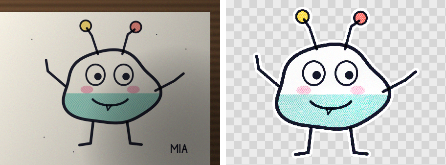
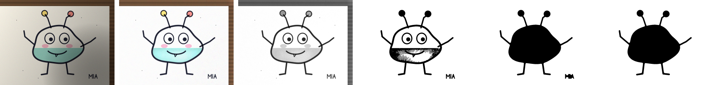
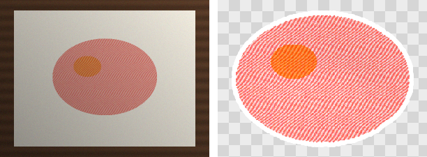
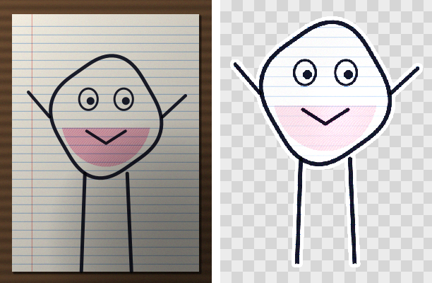

# doodle-cutout

Turn a phone photo of a drawing on paper into a clean, transparent **sticker sprite**.
Zero dependencies, TypeScript, runs in the browser (main thread or Web Worker), Node and Bun.



## Why

We built this for **Sketchlings**, a Fire TV party game where kids draw a creature on paper, snap it with a phone,
and seconds later it walks onto the TV and races the family's other drawings. A kid's photo is the worst-case input
for background removal: uneven lamp light, the phone's own shadow, a bit of table at the edge, crumbs, a signature,
and creatures drawn as *outlines* that must come out as solid stickers rather than wire frames.

General-purpose background removers are built for photos of people and products, and need a model download or a
server. Drawings on paper have a simpler structure, so a few hundred lines of classic image processing do the job
on the phone in well under a second.

## Install

```sh
npm install doodle-cutout
```

## Usage

```ts
import {cutout} from 'doodle-cutout';

const result = cutout(imageData, {outline: 8}); // any {data, width, height} RGBA image
// result.data / width / height: RGBA sprite of the drawing on transparency
// result.bbox:        where the drawing was in the photo (input pixels)
// result.palette:     dominant ink colours, e.g. ['#1f2a44', '#e8443a']
// result.inkCoverage: 0..1, how much of the shape is ink (outline vs coloured in)
```

### Browser

```ts
import {cutout} from 'doodle-cutout';

async function fileToSprite(file: File): Promise<Blob | null> {
  const bitmap = await createImageBitmap(file, {imageOrientation: 'from-image'}); // honours EXIF rotation
  const scale = Math.min(1, 1024 / Math.max(bitmap.width, bitmap.height));
  const canvas = new OffscreenCanvas(Math.round(bitmap.width * scale), Math.round(bitmap.height * scale));
  const ctx = canvas.getContext('2d')!;
  ctx.drawImage(bitmap, 0, 0, canvas.width, canvas.height);

  const sprite = cutout(ctx.getImageData(0, 0, canvas.width, canvas.height), {outline: 8});
  if (!sprite.width) return null; // no drawing found

  const out = new OffscreenCanvas(sprite.width, sprite.height);
  out.getContext('2d')!.putImageData(new ImageData(sprite.data, sprite.width, sprite.height), 0, 0);
  return out.convertToBlob({type: 'image/png'});
}
```

It is a plain synchronous function, so moving it into a **Web Worker** is just:

```ts
// cutout.worker.ts
import {cutout} from 'doodle-cutout';
self.onmessage = ({data}) => {
  const r = cutout(data.image, data.options);
  self.postMessage(r, [r.data.buffer]);
};
```

### Node / Bun

Decode the photo with whatever you already use (`sharp`, `pngjs`, `jpeg-js`...) and pass the RGBA buffer:

```ts
import sharp from 'sharp';
import {cutout} from 'doodle-cutout';

const {data, info} = await sharp('photo.jpg').rotate().ensureAlpha().raw().toBuffer({resolveWithObject: true});
const r = cutout({data, width: info.width, height: info.height}, {outline: 8});
await sharp(Buffer.from(r.data), {raw: {width: r.width, height: r.height, channels: 4}}).png().toFile('sprite.png');
```

## How it works



*Left to right: photo, lighting removed, ink score, cleaned ink, gaps closed and holes filled, final mask.*

1. **Downscale** to `maxSize` (1024 px) with an area average, compositing any transparency onto white.
2. **Estimate the paper.** A grayscale *closing* (max filter, then min filter) per channel deletes everything darker
   than the paper that is narrower than the window, which is all the ink, and keeps the lighting. Two closings are
   combined: a flat square one, exact on hard steps like the table edge, and a paraboloid "rolling ball", exact on soft
   round shadows. Both only ever overestimate, so the lower one wins. Both run in O(n) whatever the radius (a monotonic
   deque, and the lower-envelope-of-parabolas trick from the Felzenszwalb–Huttenlocher distance transform). The
   paraboloid only follows soft shadows, so it runs at half size. The estimate is taken from the same lightly denoised
   copy that is scored next: a blurrier estimate is too bright on the dark side of a hard step, which draws a 1 px
   "ink" line round a sheet lying on a dark table, and step 7 would fill the whole sheet.
3. **Flatten and score.** Dividing by the paper estimate turns the paper white, shadows included. Each pixel's ink
   score is the larger of its darkness, its colourfulness against the local paper and its saturation against the
   page's white balance (so yellow crayon counts, and so do coloured areas too big for step 2). The sensor noise is
   measured from the photo, and the score is reduced where a dark background would amplify it.
   **Ruled and squared paper:** printed lines are thin, faint, and reach even the empty parts of the sheet, while a
   drawing does not. A white top-hat (what a small opening removes) isolates thin structures; the level they reach in
   the emptiest tenth of the sheet's tiles (capped at 0.4, so dark pen always survives) is taken off thin structures
   only. The lines vanish; thick ink and strokes darker than the lines stay.
4. **Threshold** with Otsu, clamped and kept above the paper noise floor, using *hysteresis*: faint crayon touching
   confident ink is kept, isolated grain is not.
5. **Cut away what surrounds the sheet.** Thick ink touching the photo edge (a strip of table, a cloth, fingers) is
   removed pixel by pixel, together with whatever is joined to it or to the photo edge within a small margin (the
   paper's edge and its shadow). A leg drawn down to the paper's edge is trimmed there instead of taking the whole
   creature with it. Leftovers touching the cut must reach `backgroundRadius` into the photo to count as drawing, so a
   margin line or a strip of shadow goes. On a table too wide to be ink, the shadow the sheet casts is thin ink just
   off a sharp step down in the paper estimate; parts lying mostly there lose those pixels. Specks go too. If nothing is
   left, everything is kept.
6. **Close gaps** with a disk-shaped morphological closing (exact Euclidean distance transform), so an outline with a
   small gap still counts as closed.
7. **Fill holes.** Flood-fill the background from the image border; whatever it cannot reach is enclosed by the
   drawing and becomes solid. This turns an outline into a sticker.
8. **Keep the main shapes**: the largest one plus any at least `keepRatio` of its size (the signature and crumbs go).
9. **Compose the sprite.** Colours come from the photo divided by the paper colour *interpolated from around the
   drawing* (normalised convolution on a 4x smaller grid, blending into a photo-wide window inside big drawings), so
   big crayon areas keep their colour. Paper showing inside the drawing is
   whitened, ink gets a small saturation boost, the edge gets a 1-2 px soft alpha, and an optional white sticker
   outline is added with a distance transform.

On an Apple-silicon laptop a 900×675 photo takes about 0.3 s in Bun, and a 4000×3000 one about 0.4 s (it is
downscaled first); a mid-range phone takes roughly 2-3× that, so run it in a worker.





## Options

All sizes are in working-image pixels (after the downscale to `maxSize`).

| Option | Default | What it does |
|---|---|---|
| `maxSize` | `1024` | Longest side of the working image. Larger photos are area-downscaled first. |
| `backgroundRadius` | 12% of the long side | Window of the paper estimate. Must be wider than your thickest stroke. Also how far ink touching the photo edge or the table must reach into the photo to count as drawing. |
| `threshold` | `'auto'` | Ink score threshold 0..1, or `'auto'` (Otsu clamped to 0.12-0.4, above the noise floor). |
| `chromaWeight` | `0.9` | How much colourfulness counts as ink. |
| `minSpeckArea` | 0.01% of the image (min 6) | Ink blobs smaller than this are dust. |
| `closeRadius` | 0.7% of the long side (min 2) | Disk radius that bridges gaps in outlines (gaps up to about 2×). `0` disables. |
| `fillHoles` | `true` | Make regions enclosed by an outline solid. |
| `removeBorderBlobs` | `true` | Cut away what surrounds the sheet (table, fingers, the paper's edge and shadow) unless nothing else is left. |
| `keepRatio` | `0.15` | Keep the largest shape plus shapes at least this fraction of its area. |
| `padding` | `4` | Transparent margin around the sprite. |
| `feather` | `1.25` | Width of the soft alpha edge (0.5-2.5). |
| `outline` | `0` | Width of a sticker outline. `0` = none. |
| `outlineColor` | `'#ffffff'` | Sticker outline colour. |
| `whiten` | `0.6` | 0..1, how strongly paper inside the drawing is cleaned to white. |
| `inkBoost` | `1.3` | Saturation/depth boost for ink. `1` = off. |
| `paletteSize` | `5` | Max colours in `palette`. |
| `debug` | `false` | Return every intermediate buffer in `result.debug` (flattened photo, score, masks). |

## Result

| Field | |
|---|---|
| `data`, `width`, `height` | RGBA sprite, not premultiplied. `0×0` with empty `data` if no drawing was found. |
| `bbox` | `{x, y, width, height}` of the drawing in **input** pixels, without padding or outline. |
| `palette` | Dominant ink colours as `'#rrggbb'`, most common first, near-whites skipped. |
| `inkCoverage` | Fraction of the shape that is ink rather than paper. Low = outline drawing, high = coloured in. |
| `debug` | With `debug: true`: `width`, `height`, `threshold`, `weakThreshold`, `flattened` (RGBA) and 0/255 masks `score`, `ink`, `cleaned`, `closed`, `filled`, `mask`. |

## Limitations

- **Outlines must be (nearly) closed** to come out solid. Gaps up to about `2 × closeRadius` are bridged; an open
  "C" shape stays line art. Tell kids to "close the line".
- **Drawings touching the photo edge or the table.** Strokes that run into the table or off the photo are trimmed
  there and kept, but an outline cut open by the photo edge cannot be filled (it stays line art), and a thick crayon
  area touching the edge is taken for table. Leave a margin.
- **Very large solid dark areas** (a page coloured in with black crayon) can be mistaken for paper. Coloured areas
  of any size are fine; for black ones raise `backgroundRadius`.
- **Light pencil** on white paper is faint by nature; a marker or crayon works far better. A page covered edge to
  edge in light pencil hatching looks like ruled paper and is lost.
- **Ruled and squared paper** are fine, tilted or not. Lines darker than about a third of black (heavy grids) still
  count as ink, and pencil as light as the lines goes with them.
- **A sheet on a table wider than `backgroundRadius`:** a strong shadow the sheet casts on the table is removed when
  it stands apart, but can stay attached to legs drawn right down to the paper's edge.
- It finds *drawings on paper*. It is not a general background remover for photos of objects or people.

## Development

```sh
bun test             # 37 tests on synthetic photos (shadows, noise, tables, gaps, specks, ruled paper...)
bun scripts/demo.ts  # regenerates the images in examples/
npm run build        # dist/ (ESM + .d.ts)
```

The tests draw their own "photos" (`test/helpers/synth.ts`) and include a tiny PNG encoder/decoder
(`test/helpers/png.ts`) so the suite needs no image files or dependencies.

## License

MIT © StarFun Games
